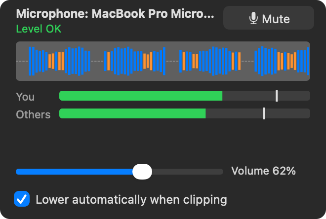

<p align="center"></p>

# meet-rec-transcribe

Registra i meeting sul Mac (la tua voce + quella degli altri partecipanti), li trascrive
**in locale** con il motore di [Vibe](https://github.com/thewh1teagle/vibe), collega la registrazione
all'evento del calendario Outlook e salva una nota in Obsidian, con riassunto opzionale.

<p align="center"></p>

Due modi di usarlo, che condividono lo stesso stato:
- **MeetRec**, app nella barra dei menu;
- **`meet`**, comando da terminale.

## Perché

L'app di Vibe a volte si blocca mentre salva una registrazione, e quando succede si perde tutto.
Qui la registrazione è separata dalla trascrizione: l'audio va su disco mentre registri, quindi un
crash non lo fa perdere.

## Cosa fa

- **Registra due tracce**: il tuo microfono e l'audio di sistema, cioè gli altri partecipanti su
  Teams, Meet, Zoom o browser. Non serve un driver audio né collegarsi alla call.
- **Livelli in tempo reale** nel menu: forma d'onda del microfono, misuratori per te e per gli
  altri, volume d'ingresso regolabile.
- **Riduzione automatica**: se il microfono va in saturazione, il volume d'ingresso scende da solo.
- **Trascrizione locale** con whisper (large-v3-turbo); l'audio non lascia il Mac.
- **Chi parla**: le tue frasi e quelle degli altri sono separate grazie alle due tracce.
- **Calendario Outlook**: titolo, invitati, agenda e link dell'evento in corso.
- **Riassunto** opzionale con Claude (solo testo): sintesi, decisioni, action item, punti aperti.
- **Nota Obsidian** con frontmatter, persone collegate e transcript con i tempi.

## Screenshot

| Livelli audio nel menu | Impostazioni |
|---|---|
|  |  |

Nel pannello dei livelli:
- **forma d'onda**: gli ultimi 9 secondi del microfono. Blu = ok, arancione = basso,
  rosso = vicino alla saturazione;
- **Tu / Altri**: livello medio (barra) e picco (tacca);
- **stato**: "Basso: alza il volume", "Livello OK", "Satura: abbassa il volume";
- **slider**: il volume d'ingresso del microfono in macOS, lo stesso di Impostazioni di
  Sistema > Suono. Vale anche per Teams;
- **Riduci automaticamente se satura**: abbassa il volume del 15% a ogni saturazione, al massimo
  una volta ogni 2 secondi. Non lo alza mai da solo.

A menu aperto senza registrazione, il pannello ascolta il microfono: puoi regolarlo prima del meeting.

## Requisiti

- macOS 15 o successivo
- Xcode Command Line Tools (`swiftc`)
- `ffmpeg` (`brew install ffmpeg`)
- [Vibe](https://github.com/thewh1teagle/vibe) in `/Applications`, con un modello whisper scaricato
  (di default `ggml-large-v3-turbo.bin`)
- Python 3.10 o successivo
- opzionale: [Claude Code](https://claude.com/claude-code) (`claude`) per il riassunto

## Installazione

```sh
git clone git@gitlab.com:fabiottini/meet-rec-transcribe.git
cd meet-rec-transcribe
./install.sh
```

`install.sh` compila il registratore e l'app, crea `.venv` con `msal`, installa il comando
`~/.local/bin/meet` e l'app `~/Applications/MeetRec.app`, poi avvia l'app.

Poi apri **MeetRec > Impostazioni** e:
1. scegli il **vault** Obsidian e le cartelle dei meeting e delle persone;
2. fai **Login Microsoft**: si apre il browser e il codice è già negli appunti;
3. se vuoi, attiva **Avvia MeetRec al login**.

Alla prima registrazione macOS chiede due permessi per MeetRec: **Microfono** e **Registrazione
schermo e audio di sistema**. Dopo averli concessi, chiudi e riapri MeetRec.

> Se usi un gestore della barra dei menu (Ice, Bartender…), l'icona può finire nella zona nascosta:
> trascinala fuori.

## Uso

### Barra dei menu
| Icona | Stato |
|---|---|
| quadrato bianco con onda | pronto |
| quadrato rosso + timer | sta registrando; le barre seguono la tua voce |
| quadrato arancione | il registratore si è fermato: ferma per salvare |
| quadrato bianco + `…` | sta trascrivendo |

Il menu ha queste voci: livelli audio, avvia (anche con un titolo), ferma ed elabora, ferma senza
elaborare, registrazioni da elaborare, apri l'ultima nota in Obsidian, cartella registrazioni, log,
impostazioni.

### Terminale
```
meet start [-t "titolo"]   # registra in background
meet status
meet stop                  # ferma, trascrive, cerca l'evento, scrive la nota
meet rec                   # in primo piano, Ctrl-C per fermare
meet recover               # registrazioni mai elaborate (crash, riavvio)
meet process <cartella>    # rielabora una registrazione
meet login | logout | whoami
meet events [YYYY-MM-DD]   # eventi del calendario di un giorno
meet mics                  # microfoni disponibili
```

## Qualità della trascrizione: il microfono conta

Le cuffie Bluetooth (AirPods, Sony WH-1000XM…), quando usi il loro microfono, passano al profilo
"telefono": audio a 16 kHz, banda stretta, spesso molto basso. Whisper sbaglia molto di più.

- Guarda il pannello dei livelli: il parlato deve stare nella zona blu, "Livello OK".
- Se puoi, usa il **microfono del Mac** o uno USB (Impostazioni > Microfono), anche in Teams.
  Le cuffie restano in alta qualità per l'ascolto.
- Il volume d'ingresso di alcune cuffie Bluetooth non è regolabile da macOS: lo slider lo dice
  ("non regolabile").

## Come funziona

1. **Registrazione** (`capture/main.swift`, ScreenCaptureKit). Due tracce separate,
   microfono e audio di sistema, scritte come PCM grezzo mentre registri. Le tracce restano
   allineate perché i buchi vengono riempiti di silenzio. Se il microfono cambia formato a metà,
   parte un nuovo segmento. Ogni 100 ms il registratore scrive i livelli nel file `levels` per
   l'app e, se attiva, applica la riduzione automatica.
2. **Audio**. Il grezzo diventa `mic.m4a`, `system.m4a` e `mix.m4a`. Il grezzo viene cancellato
   solo se le durate degli m4a tornano.
3. **Trascrizione**. `vibe serve` in locale, una traccia alla volta, con i timestamp. Le tracce
   distinguono chi parla: microfono = `me`, audio di sistema = `others_label`. Vengono scartati:
   - il testo che whisper inventa sulle tracce mute (controllo sul volume);
   - le frasi doppie che il microfono raccoglie dagli altoparlanti.
4. **Calendario**. Microsoft Graph `calendarView`: sceglie l'evento che si sovrappone di più
   alla registrazione.
5. **Riassunto** (opzionale). `claude -p` riceve **solo il testo** della trascrizione.
6. **Nota**. `<vault>/<meetings_dir>/YYYY-MM/YYYY-MM-DD - <titolo>.md` con frontmatter
   (`type: meeting`, `context`, `summary`, `people`, `date`, orari, link alla registrazione e
   all'evento). Gli invitati che hanno una nota `nome_cognome.md` in `people_dir` vengono collegati.

## Configurazione

`~/.config/meetrec/config.json`, modificabile anche da Impostazioni. Esempio in
[`config.example.json`](config.example.json).

| Chiave | Default | Note |
|---|---|---|
| `vault` | — | obbligatoria |
| `meetings_dir` | `Meetings` | relativa al vault |
| `people_dir` | `People` | relativa al vault |
| `context` | `work` | valore di `context:` nel frontmatter |
| `recordings_dir` | `~/Recordings/meetings` | |
| `language` | `it` | lingua passata a whisper |
| `ui_language` | lingua di sistema | lingua di menu e messaggi dell'app: `it` o `en` (Impostazioni > Interfaccia) |
| `me` / `others_label` | `Me` / `Altri` | etichette delle due tracce |
| `mic_id` | `null` | `null` = microfono di sistema; gli ID con `meet mics` |
| `auto_gain` | `true` | abbassa il volume del microfono quando satura |
| `summary` | `true` | |
| `summary_cmd` | `["claude","-p","--model","sonnet"]` | il prompt arriva su stdin |
| `keep_raw` | `false` | tiene anche il PCM grezzo |
| `vibe_bin`, `vibe_model`, `ffmpeg` | path standard | |
| `ms_client_id`, `ms_authority` | client pubblico, `organizations` | login device code, solo `Calendars.Read` |
| `timezone` | `Europe/Rome` | |

Il token Microsoft è in `~/.config/meetrec/msal_cache.json` (permessi 0600).

## Limiti noti

- Gli altri partecipanti sono tutti in una sola traccia: non vengono distinti tra loro.
- Senza cuffie il microfono raccoglie anche gli altoparlanti. Le frasi doppie vengono filtrate,
  ma con le cuffie la trascrizione viene più pulita.
- L'app è firmata ad-hoc. Dopo ogni `./install.sh` macOS può chiedere di nuovo i permessi.

## Struttura

```
capture/main.swift        registratore (ScreenCaptureKit), livelli, riduzione automatica
menubar/main.swift        app barra dei menu (AppKit + SwiftUI), usa il comando `meet`
menubar/LevelPanel.swift  pannello livelli audio e anteprima del microfono
shared/MicVolume.swift    volume d'ingresso del microfono (Core Audio), condiviso
menubar/Info.plist
assets/                   icona (make-icon.swift genera il PNG, AppIcon.icns per l'app)
docs/                     immagini del README (MeetRec --render-docs docs)
meet.py                   CLI: registrazione, audio, trascrizione, calendario, nota
install.sh
```
