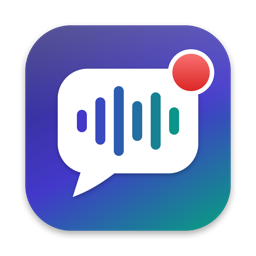
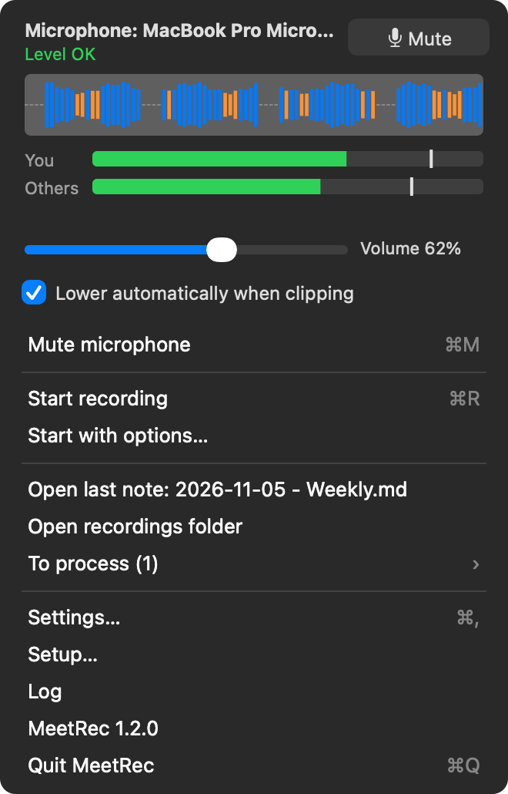
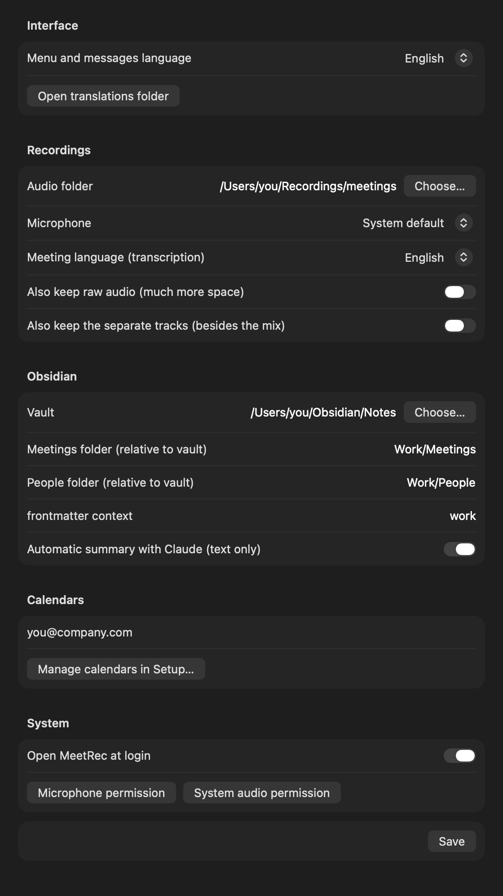

<p align="center"></p>

# meet-rec-transcribe

Records meetings on your Mac (your voice and the other participants' voices) and transcribes them
**locally** with [whisper.cpp](https://github.com/ggml-org/whisper.cpp). It links each recording to
the calendar event (Microsoft, Google, iCloud… as many accounts as you want) and saves a note in
Obsidian, with an optional summary.

<p align="center"></p>

There are two ways to use it, and they share the same state:
- **MeetRec**, a menu bar app;
- **`meet`**, a command line tool.

> **Personal project, shared as is.** MIT license, no support and no warranty: issues and pull
> requests are welcome, answers are not guaranteed. macOS only.
>
> Source: [GitLab](https://gitlab.com/fabiottini/meet-rec-transcribe) (main) ·
> [GitHub](https://github.com/fabiottini/meetrec) (mirror).

## Why

The [Vibe](https://github.com/thewh1teagle/vibe) app sometimes freezes while it saves a recording,
and then the whole recording is lost. MeetRec keeps recording and transcription apart: audio goes
to disk while you record, so a crash does not lose it.

## What it does

- **Records two tracks**: your microphone and the system audio, that is the other participants on
  Teams, Meet, Zoom or a browser. You do not need an audio driver, and MeetRec does not join the call.
- **Live levels** in the menu: microphone waveform, meters for you and for the others, and the
  input volume.
- **Automatic gain reduction**: if the microphone clips, the input volume goes down by itself.
- **Call detection**: when a call starts (another app opens the microphone), a small prompt offers
  **Record**, with the meeting title if a calendar has it; when the call ends while recording, it
  offers **Stop and process**.
- **Choose what to record**: your voice and the others, or only your voice; transcript separate
  (you / others) or single (from the mix).
- **Voice profiles**: alter the voice in the saved audio (higher, deeper, robot, radio) so a listener
  cannot tell who spoke, while the transcript stays correct.
- **Keep or delete the audio** after the transcript, only once the note and the transcript are
  checked.
- **Mute switch**: mutes the microphone for every app (Teams included) until you switch it off.
- **Local transcription** with whisper.cpp (large-v3-turbo) and a silence filter. The audio stays on
  your Mac.
- **Who is speaking**: your words and the others' words are kept apart, thanks to the two tracks.
- **Every calendar you use**: Microsoft 365 and Outlook.com, Google, and anything in the macOS
  Calendar app, with as many accounts as you want. When you stop, MeetRec asks which meeting it was.
- **Summary** with Claude, optional and text only: key points, decisions, action items, open
  questions.
- **Obsidian note** with frontmatter, linked people and a timestamped transcript.

## Screenshots

| Menu | Settings |
|---|---|
|  |  |

The top of the menu shows the level panel:
- **waveform**: the last 9 seconds of the microphone. Blue means OK, orange means low, red means
  close to clipping;
- **You / Others**: average level (bar) and peak (tick);
- **status**: "Low: raise the mic volume", "Level OK", "Clipping: lower the volume";
- **slider**: the microphone input volume in macOS, the same one as in System Settings > Sound.
  It also applies to Teams;
- **Lower automatically when clipping**: lowers the volume by 15% each time the mic clips, at most
  once every 2 seconds. It never raises the volume.

When the menu is open and you are not recording, the panel listens to the microphone, so you can
set the level before the meeting.

**Mute microphone** (menu item, ⌘M, or the Mute button in the panel) is a switch, off by default.
When it is on:
- the microphone is muted in macOS, so every app hears nothing;
- it is forced: MeetRec checks every second and mutes it again if another app unmutes it, also
  when you change the default input;
- if the microphone has no mute control (some Bluetooth headsets), MeetRec sets its input volume
  to 0 and restores the old volume afterwards;
- the menu bar icon shows a slash;
- if you record while muted, your voice is not recorded and the panel tells you.

Switching it off, or quitting MeetRec, restores the microphone as it was.

## Installation

A prebuilt app is in the repo: [`dist/MeetRec.zip`](dist/MeetRec.zip) (Apple Silicon and Intel,
macOS 15 or later).

1. Download `dist/MeetRec.zip` from GitLab, unzip it and move **MeetRec** to Applications.
2. Open it. The app is not signed with an Apple certificate, so macOS blocks it the first time.
   Go to **System Settings > Privacy & Security** and click **Open Anyway**.
   Or, from Terminal: `xattr -dr com.apple.quarantine /Applications/MeetRec.app`.
3. The **Setup** window opens. It checks everything and installs what is missing:

| Item | What the button does |
|---|---|
| Homebrew | copies the install command and opens brew.sh |
| Python 3, ffmpeg, whisper.cpp | `brew install …`, with the log shown |
| Transcription model | downloads whisper large-v3-turbo (1.6 GB) and the silence filter; if Vibe is installed, copies them from Vibe |
| Microphone and system audio permissions | asks macOS (for system audio, reopen the app afterwards) |
| Obsidian vault | choose the folder |
| Calendars (optional) | add Microsoft, Google and macOS Calendar accounts, see [Calendars](#calendars) |
| Claude Code (optional) | needed for the summary; without it the note has only the transcript |
| `meet` command (optional) | installs `~/.local/bin/meet`, which uses the app |

Setup opens again by itself while something required is missing. After that it is in the menu,
under **Setup…**. The other options (folders, microphone, languages, summary…) are in **Settings**.

> If you use a menu bar manager (Ice, Bartender…), the icon may end up in the hidden section.
> Drag it out.

### Build, install and release with make

You need the Xcode Command Line Tools (`swiftc`); `make docs` also needs `ffmpeg`.

```sh
git clone git@gitlab.com:fabiottini/meet-rec-transcribe.git
cd meet-rec-transcribe
make                # list the targets
```

| Command | What it does |
|---|---|
| `make build` | builds `dist/MeetRec.app` (Apple Silicon + Intel) and `dist/MeetRec.zip` |
| `make install` | build, copy to `~/Applications`, open (refuses while a recording is running) |
| `make install-zip` | installs the committed `dist/MeetRec.zip`, without building |
| `make open` | opens the installed app |
| `make cli` | installs the `meet` command (`~/.local/bin/meet`), using the installed app |
| `make check` | syntax check of `meet.py`, locale keys in every language, `Info.plist` |
| `make docs` | renders the README images in `docs/` from the app, in English |
| `make release` | `check` + `build` + `docs`: then commit with `dist/MeetRec.zip` and `docs/` |
| `make uninstall` | removes the app and the `meet` command (config, tokens and recordings are kept) |
| `make clean` | removes `dist/MeetRec.app` (the zip stays) |

**Versions** follow [Semantic Versioning](https://semver.org/) (`MAJOR.MINOR.PATCH`): the version is
in `VERSION`, shown at the bottom of the menu and by `meet --version`, and every release is listed in
[`CHANGELOG.md`](CHANGELOG.md) and tagged `vX.Y.Z` in git.

| Command | What it does |
|---|---|
| `make version` | prints the version |
| `make bump-patch` / `bump-minor` / `bump-major` | fix / new feature / breaking change |
| `make tag` | on `main` after the merge: creates and pushes `vX.Y.Z` (checks clean tree, changelog, zip version) |

**Two copies**: GitLab (`origin`, where branches and merge requests live) and a private mirror on
GitHub (`github`, `fabiottini/meetrec`). `make sync-github` copies `main` and the tags there (never
forced: it stops if GitHub has diverged); `make tag` runs it after each release.

The usual flow after a change: `make bump-…` and a `CHANGELOG.md` section, `make release`, then commit
(code, `dist/MeetRec.zip`, `docs/`) on a branch, push and open a merge request; after the merge,
`make tag` on `main` (it also updates GitHub), and `make install-zip` on every Mac. After a merge
without a new version, `make sync-github`.
Each new build has a different signature, so macOS asks for the microphone and system audio
permissions again.

## Usage

### Menu bar
| Icon | State |
|---|---|
| white square with a waveform | ready |
| red square + timer | recording; the bars follow your voice |
| orange square | the recorder stopped: stop to save |
| white square + `…` | transcribing |

The menu has: audio levels, start (optionally with a title), stop and process, stop without
processing, stop and discard (asks for confirmation, deletes the audio), recordings to process
(each one can be processed or deleted), open the last note in Obsidian, recordings folder, log,
settings, setup.

### Recording options, voice profiles, audio after the transcript

Defaults are in **Settings > Recording and audio**; **Start with options…** in the menu changes them
for one recording (title, what to record, transcript, voice profile).

- **What to record**: *My voice and the others* (two tracks, as usual) or *Only my voice* (no system
  audio).
- **Transcript**: *Separate* (You / Others, from the two tracks) or *Single* (one transcript from the
  mix, speakers not separated).
- **Voice profile**: changes the voice in the **saved** audio. The transcript is made on the
  original first, then the original audio is replaced (never kept). Apply it to *only my voice* or
  *all voices*; **Try** records 5 seconds from your mic and plays original and profile.

  | Profile | Effect | Same words as the original voice* |
  |---|---|---|
  | 1 – higher | pitch and formants up, frequencies shifted | 84–96% |
  | 2 – deeper | pitch and formants down, shifted, light chorus | 86–93% |
  | 3 – robot | intonation removed, slightly higher | 81–89% |
  | 4 – radio | phone band, higher, light vibrato | 84–92% |

  \*whisper on 60 s of real calls (mixed audio and a Bluetooth headset mic). Every profile is
  loudness-normalised, so the altered voice is as loud as a normal one. Profiles hide the timbre, not the content: people who know you
  may still recognise how you talk. Profiles 1 and 2 only shift pitch and can be partly undone;
  3 and 4 throw information away and are harder to reverse.
- **Audio after the transcript**: *Ask every time* (default), *Always keep*, or *Always delete*.
  Before deleting, MeetRec checks that the note exists in the vault with its transcript section,
  that the transcript is not empty and that the saved transcription files are there; if anything is
  missing the audio is kept and you are told why. Only audio files are deleted: transcript, saved
  transcription and note stay, so `meet process` can still rebuild the note. In the note the
  recording link becomes "Audio eliminato dopo la trascrizione il …".

### Call detection

When another app keeps the microphone open for a few seconds (Teams, Zoom, Meet in a browser,
FaceTime, Slack…), a small prompt appears in the top right corner: "Call in progress on Microsoft
Teams", with the meeting title when one of your calendars has it, and **Record** / **Ignore**.
When that app releases the microphone while MeetRec is recording, the prompt offers **Stop and
process** / **Keep recording**. The prompt goes away by itself after a minute.

It uses the macOS per-process microphone state: nothing is recorded until you press Record, and
dictation and Siri are ignored. Turn it off in Settings ("Offer to record when a call starts",
`call_prompt` in config.json). `meet now` lists the meetings going on now in every calendar.

### Import an audio file

You can also process a file you already have (mp3, wav, m4a, aac, flac, ogg… anything ffmpeg
reads): menu **Import audio file…** (⌘I), drag the file onto the MeetRec icon in Finder, use
**Open With > MeetRec**, or `meet import <file>`.

- The meeting time, used to find the calendar event, comes from the file: its recording date if
  it has one, otherwise its modification date minus the duration. Set it with
  `--at "YYYY-MM-DD HH:MM"`.
- An imported file is one track, so the transcript does not tell you and the others apart.
- The original file is not changed; MeetRec keeps a `mix.m4a` copy with the other recordings.

### Command line
```
meet start [-t "title"]   # record in the background
meet status
meet stop                 # stop, transcribe, find the event, write the note
meet stop --discard       # stop and delete the recording
meet start --mic-only | --with-system  [--transcript separate|mixed] [--voice-profile p1..p4] [--voice-scope mine|all]
meet verify <folder>      # check note + transcript of a processed recording
meet drop-audio <folder>  # delete its audio (only if verify is OK)
meet voice-test p1..p4    # hear a voice profile on 5 seconds of your mic
meet discard <folder>     # delete a recording (e.g. from meet recover)
meet rec                  # in the foreground, Ctrl-C to stop
meet recover              # recordings never processed (crash, reboot)
meet process <folder>     # process a recording again
meet import <file> [-t "title"] [--at "YYYY-MM-DD HH:MM"]   # process an existing audio file
meet accounts                                  # calendar accounts
meet account add microsoft | google | macos
meet account remove <id>
meet events [YYYY-MM-DD]                       # events of a day from every account
meet candidates <folder> / meet choose <folder> <n|none>
meet choose <folder> manual --title "…" [--start ISO --end ISO --people "a, b" --agenda "…"]
meet mics                 # available microphones
```

## Calendars

Add accounts in **Setup > Calendars**, as many as you want. MeetRec reads **every calendar** of each
account (secondary and shared ones too) and shows an event only once if it appears in two places.

| Your calendar | How to add it |
|---|---|
| Microsoft 365 (work or school), Outlook.com, Hotmail, Live | **+ Microsoft**: sign in with the code (already in the clipboard) |
| Gmail, Google Workspace | **+ Google**, see below |
| iCloud, Yahoo, CalDAV, Exchange on-premises, subscribed `.ics` calendars | add them to the macOS Calendar app, then **+ macOS Calendar** |
| A company that blocks third-party apps on Microsoft 365 | add the account to the macOS Calendar app, or subscribe to its published `.ics` link there |

**Microsoft** needs your own app registration, once (free): **+ Microsoft** opens a guide. In
[Microsoft Entra](https://entra.microsoft.com) > App registrations > New registration: name
`MeetRec`, supported accounts "any organizational directory and personal Microsoft accounts", no
redirect URI; then Authentication > Allow public client flows = Yes; API permissions > Microsoft
Graph > Delegated: `Calendars.Read`, `Calendars.Read.Shared`. Copy the Application (client) ID into
the guide (or `meet account ms-client <id>`). If your company does not let you register apps, use the
macOS Calendar route.

**Google** needs your own OAuth client, once (Google does not allow calendar access with a sign-in
code): in [Google Cloud Console](https://console.cloud.google.com/apis/credentials) create a
project, enable the **Google Calendar API**, set up the consent screen (External; add your
addresses as test users, or publish the app so logins do not expire after 7 days) and create an
**OAuth client ID** of type **Desktop app**. Download its JSON and choose it when Setup asks.
After that, each **+ Google** opens the browser to sign in with one more account.

**When you stop a recording** (or import a file), MeetRec lists the events found in every calendar
at that time, the most likely one selected, plus "None of these" and "Something else: I'll write
it…". The last one opens a form for a meeting that is in no calendar: title, day, start and end
(prefilled with the recording times), attendees (names or emails, comma separated) and an optional
agenda. The note then uses them like a calendar event (title, day, linked people, summary). The
same choice appears when no calendar has anything at that time. Your choice sets the note title,
attendees and agenda. "Decide later" keeps the recording in **To process**. From the command line,
`meet stop` asks the same question in the terminal.

## Transcription quality: the microphone matters

Bluetooth headphones (AirPods, Sony WH-1000XM…) switch to the "headset" profile when you use their
microphone: 16 kHz, narrow band, often very quiet. Whisper makes many more mistakes.

- Check the level panel: speech should stay in the blue zone, "Level OK".
- If you can, use the **Mac's microphone** or a USB one (Settings > Microphone), in Teams too.
  Your headphones then keep high quality for listening.
- Some Bluetooth headsets do not let macOS change their input volume. The slider then shows
  "not adjustable".

## How it works

1. **Recording** (`capture/main.swift`, ScreenCaptureKit). Two separate tracks, microphone and
   system audio, written as raw PCM while you record. Gaps are filled with silence, so the tracks
   stay aligned. If the microphone changes format midway, a new segment starts. Every 100 ms the
   recorder writes the levels to a `levels` file for the app and, when it is on, applies automatic
   gain reduction.
2. **Audio**. The raw audio becomes `mic.m4a`, `system.m4a` and `mix.m4a`. The raw files are deleted
   only if the m4a durations match. When processing ends, only `mix.m4a` is kept. The transcriptions
   of the two tracks are saved, so `meet process` can rebuild the note without the separate tracks.
3. **Transcription**. `whisper-cli` (whisper.cpp) runs locally, one track at a time, with timestamps
   and the silence filter (about 2x faster). If whisper.cpp is missing and Vibe is installed, it
   uses `vibe serve`. The tracks tell who is speaking: microphone = `me`, system audio =
   `others_label`. It drops:
   - text that whisper makes up on silent tracks (loudness check);
   - duplicate sentences that the microphone picks up from the speakers.
4. **Calendar**. Events of every account that overlap the recording (or start within 10 minutes
   of it); you pick one when you stop. If you do not pick (`meet process` alone), it takes the
   event that overlaps the most.
5. **Summary** (optional). `claude -p` receives **only the text** of the transcript.
6. **Note**. `<vault>/<meetings_dir>/YYYY-MM/YYYY-MM-DD - <title>.md` with frontmatter
   (`type: meeting`, `context`, `summary`, `people`, `date`, times, links to the recording and
   to the event). Attendees with a `firstname_lastname.md` note in `people_dir` are linked.
   The note text is in Italian.

## Configuration

`~/.config/meetrec/config.json`, also editable from Settings. Example in
[`config.example.json`](config.example.json).

| Key | Default | Notes |
|---|---|---|
| `vault` | — | required |
| `meetings_dir` | `Meetings` | relative to the vault |
| `people_dir` | `People` | relative to the vault |
| `context` | `work` | value of `context:` in the frontmatter |
| `recordings_dir` | `~/Recordings/meetings` | |
| `language` | `it` | language passed to whisper |
| `ui_language` | system language | language of the app menus and messages (Settings > Interface), see [Languages](#languages) |
| `me` / `others_label` | `Me` / `Altri` | labels of the two tracks |
| `mic_id` | `null` | `null` = system microphone; IDs from `meet mics` |
| `auto_gain` | `true` | lowers the microphone volume when it clips |
| `summary` | `true` | |
| `summary_cmd` | `["claude","-p","--model","sonnet"]` | the prompt is sent on stdin |
| `keep_raw` | `false` | also keeps the raw PCM |
| `record_system` | `true` | `false`: record only my voice |
| `transcript_mode` | `separate` | `separate` (you / others) or `mixed` (one transcript from the mix) |
| `voice_profile` | `none` | `p1`…`p4`: alter the voice in the saved audio |
| `voice_profile_scope` | `mine` | `mine` (only my voice) or `all` |
| `after_process_audio` | `ask` | `ask`, `keep`, `delete` (delete only after the check) |
| `call_prompt` | `true` | offer to record when a call starts, and to stop when it ends |
| `keep_tracks` | `false` | also keeps `mic.m4a` and `system.m4a` after processing; otherwise only `mix.m4a` is kept |
| `whisper_bin`, `whisper_model`, `vad_model` | found automatically | whisper.cpp and models (`~/Library/Application Support/MeetRec/models`) |
| `whisper_threads` | `4` | transcription threads: keeps the Mac responsive |
| `ffmpeg`, `vibe_bin`, `vibe_model` | found automatically | Vibe is only a fallback |
| `calendar_accounts` | `[]` | managed by Setup or `meet account …` |
| `ms_client_id` | — | your Microsoft app registration (Setup > + Microsoft, or `meet account ms-client <id>`) |
| `ms_authority` | `organizations` | Microsoft login endpoint for work/school accounts |
| `timezone` | `Europe/Rome` | |

Tokens are in `~/.config/meetrec/tokens/<account>.json` (mode 0600). Logins use only the Python
standard library.

## Languages

The app texts (menu, level panel, settings, alerts, notifications) are in JSON files, one per
language: [`locales/it.json`](locales/it.json), [`locales/en.json`](locales/en.json).

```json
{
  "_language_name": "English",
  "start_recording": "Start recording",
  "login_code_copied": "Code {code} copied to the clipboard: ..."
}
```

- `_language_name` is the name shown in Settings > Interface.
- `{name}` is a placeholder that the app fills in (for example `{code}`).
- If a key is missing, the app uses English.

To add a language or change a sentence **without rebuilding**, put the file in
`~/.config/meetrec/locales/<code>.json` (the "Open translations folder" button in Settings).
Only the keys you want to change are needed; the others come from the file inside the app.
The new language appears in the list the next time you open Settings.
To ship it with the app, add it to `locales/` and run `./install.sh`.

## Privacy and consent

- Audio, transcription, calendar data and notes stay on your Mac. Calendar logins talk only to
  Microsoft and Google; tokens are in `~/.config/meetrec/tokens/` (mode 0600).
- With **Automatic summary** on, the **text** of the transcript is sent to Claude through your Claude
  Code (`summary_cmd`). Turn it off, or point `summary_cmd` to a local model, to keep everything
  offline.
- **Tell the people in the call that you are recording** and ask for consent where the law requires
  it: rules differ by country (and by US state), and recording without saying so can be illegal.
  MeetRec shows this once before the first recording; you are responsible for how you use it.

## Third-party components

MeetRec does not bundle them; the Setup installs or downloads them:
[whisper.cpp](https://github.com/ggml-org/whisper.cpp) (MIT) and the
[whisper large-v3-turbo](https://huggingface.co/ggerganov/whisper.cpp) model,
[Silero VAD](https://github.com/snakers4/silero-vad) (MIT) through the ggml-org whisper-vad files,
[FFmpeg](https://ffmpeg.org) (LGPL/GPL, from Homebrew),
[Claude Code](https://claude.com/claude-code) for the optional summary (your own account).
[Vibe](https://github.com/thewh1teagle/vibe) is supported as a fallback transcriber.

## Known limits

- All the other participants share one track, so they are not told apart.
- Without headphones the microphone also picks up the speakers. Duplicate sentences are filtered,
  but with headphones the transcript is cleaner.
- The app is ad-hoc signed, so after each new build macOS may ask for the permissions again.

## License

[MIT](LICENSE) © 2026 Fabio Lucattini

## Layout

```
dist/MeetRec.zip          prebuilt app (universal), ready to download
capture/main.swift        recorder (ScreenCaptureKit), levels, automatic gain reduction
menubar/main.swift        menu bar app (AppKit + SwiftUI)
menubar/Setup.swift       guided setup: dependencies, models, permissions, vault, login
menubar/LevelPanel.swift  audio level panel and microphone preview
shared/MicVolume.swift    microphone input volume (Core Audio), shared
menubar/Info.plist
meet.py                   recording, audio, transcription, calendar, note (also the `meet` CLI)
locales/                  UI texts, one JSON file per language
assets/                   icon (make-icon.swift draws the PNG, AppIcon.icns for the app)
docs/                     README images (MeetRec --render-docs docs)
Makefile, build.sh, install.sh
VERSION, CHANGELOG.md       version (semver) and release notes
scripts/check_locales.py  used by make check
```
